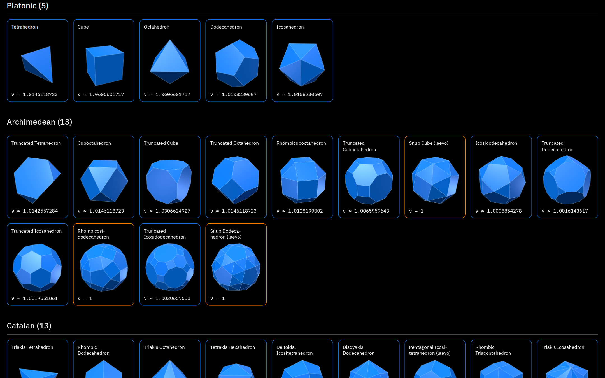
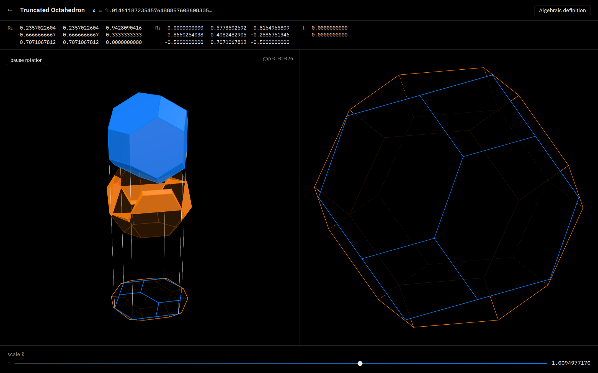
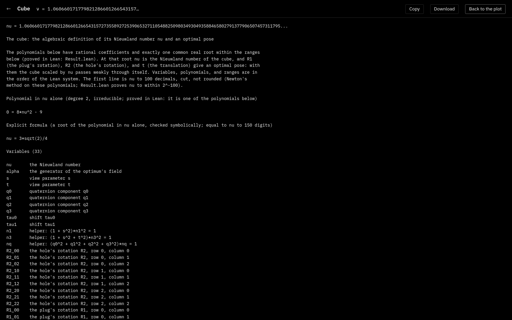
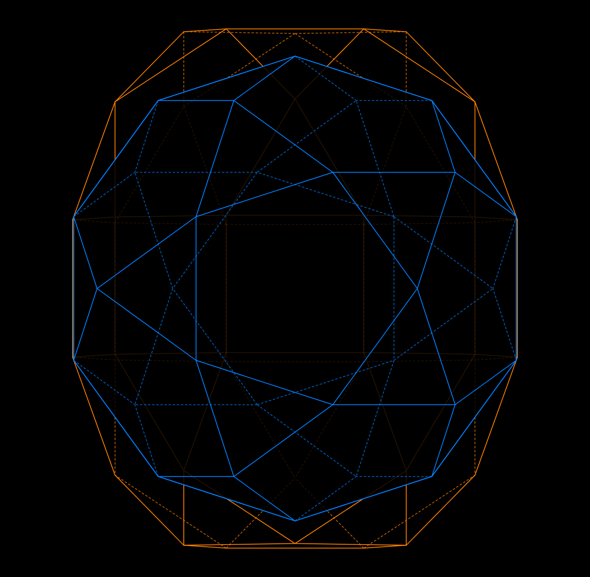

# Nieuwland numbers of convex polyhedra, proved in Lean

*Bence Hervay*

**[Open the Rupertness and Nieuwland explorer](https://bence.io/nieuwland-explorer/)**, or run it from this repository
([below](#the-explorer-1)). Click a picture to see it in full.

|  |  |  |
| :-: | :-: | :-: |
| The atlas: every solid with its ν | The truncated octahedron on its way through itself, the plug (blue) scaled by ℓ between 1 and ν | The cube: the algebraic definition of ν = 3√2/4 and an optimal pose |

## Background

Proving the **[Non-Rupertness of the Rhombicosidodecahedron](https://bence.io/ruperts-problem.pdf)**
([program and certificate](https://github.com/bence-hervay/nopert-rid)) was one of my largest
self-motivated research projects, taking **more than 1000 hours over two years**. It needed
**numerous novel ideas**, and I did it with minimal AI assistance (mostly for coding, and for
quickly putting the article together once the proof was finished).

Afterwards I had many ideas to go further:

* **generalising my techniques to arbitrary polyhedra**
* **proving stronger claims** in this topic
* **verifying everything in Lean** for higher confidence (although my original attempt relied on
  exact arithmetic, the theory wasn't formally verified)

Although I had targeted only the rhombicosidodecahedron, many of my techniques turned out to
generalise to basically arbitrary convex solids. With significant further work (this time with
heavy AI assistance), I developed a system of **provably bounded and empirically fast
algorithms** that answer various questions about Rupertness automatically (or, for some more
obscure solids, semi-automatically, with geometric “hints” that make the computation more
practical). This repository holds the Lean proofs of my results, and I put the explorer together
to present some of them visually and interactively!

## What this repository contains

* **A Lean-verified Rupertness result for 174 solids**, 151 Rupert and 23 Nopert:
  * Platonic solids (5)
  * Archimedean solids (13)
  * Catalan solids (13)
  * Johnson solids (92)
  * Prisms (P<sub>n</sub>) (9)
  * Antiprisms (A<sub>n</sub>) (9)
  * Dipyramids (P<sub>n</sub><sup>*</sup>) (9)
  * Trapezohedra (A<sub>n</sub><sup>*</sup>) (9)
  * Triakis tetrahedra (T<sub>α</sub>) (9)
  * Other (6)
* **A Lean-verified exact Nieuwland number ν** for each of these solids.
* **A Lean-verified exact optimal pose** (for the Rupert ones) that yields a weak fit after
  scaling by ν.

All Nieuwland numbers and poses are specified algebraically, by polynomial systems over the
rationals with respective rational bounding boxes that contain exactly one root!

## Highlights

* **The [rhombicosidodecahedron](https://bence.io/nieuwland-explorer/solids/archimedean_rhombicosidodecahedron)**,
  a Nopert: the solid I proved non-Rupert myself, with minimal AI assistance
  ([Background](#background)). Here that proof is checked in Lean.
* **The [Noperthedron](https://bence.io/nieuwland-explorer/solids/external_noperthedron)** of
  Steininger and Yurkevich, with 90 vertices: the first Nopert ever discovered.
* **The [Septopert](https://bence.io/nieuwland-explorer/solids/external_tom7_septopert)** of Tom 7:
  the first Nopert with the fewest possible vertices, seven. Tom 7 also proved that fewer vertices
  are not enough.
* **The smallest ν.** The
  [hexagonal trapezohedron](https://bence.io/nieuwland-explorer/solids/trapezohedron_hexagonal-trapezohedron)
  A<sub>6</sub><sup>*</sup> (ν = 1.0000006133…) and the
  [triakis tetrahedron](https://bence.io/nieuwland-explorer/solids/catalan_triakis-tetrahedron)
  (ν = 1.0000040886…) are Rupert, but only just: ν − 1 is about 6 · 10⁻⁷ and 4 · 10⁻⁶. Next come
  the gyroelongated square bicupola (ν = 1.0000320427…) and the square trapezohedron
  A<sub>4</sub><sup>*</sup> (ν = 1.0000685506…).
* **The highest algebraic degree.** For the
  [bilunabirotunda](https://bence.io/nieuwland-explorer/solids/johnson_bilunabirotunda)
  (J<sub>91</sub>, 14 vertices) and the
  [gyroelongated triangular cupola](https://bence.io/nieuwland-explorer/solids/johnson_gyroelongated-triangular-cupola)
  (J<sub>22</sub>, 15 vertices), ν is a root of an irreducible polynomial of degree 176. Among the
  Archimedean solids the truncated dodecahedron's is the highest, 112, while the
  [rhombicuboctahedron](https://bence.io/nieuwland-explorer/solids/archimedean_rhombicuboctahedron),
  with only 24 vertices, reaches 52. These polynomials are numerical, not proved: each was found by an
  integer relation search at the search program's optimum and vanishes at the Lean-proved ν to 2000
  digits (`nu_polynomial_evidence` in `data.json`). In Lean each ν is the unique root of its system.
  35 Rupert solids have no polynomial in ν alone yet.
* **The elongated pentagonal gyrobirotunda**
  ([J<sub>43</sub>](https://bence.io/nieuwland-explorer/solids/johnson_elongated-pentagonal-gyrobirotunda)),
  for its shadows at the optimum, ν = 1.0460556844…:

  
* **The hardest proofs.** The
  [tetrahedron](https://bence.io/nieuwland-explorer/solids/platonic_tetrahedron), with only four
  vertices, needs 607 MB of Lean in 643 modules, twenty times the cube's 30 MB in 65 modules. The
  hexagonal trapezohedron A<sub>6</sub><sup>*</sup>, whose ν is the closest to 1, was the hardest
  of the dipyramids and trapezohedra: its optimum is so flat that finding the certificate needed
  arithmetic beyond double precision.
* **The largest proof.** The
  [metagyrate diminished rhombicosidodecahedron](https://bence.io/nieuwland-explorer/solids/johnson_metagyrate-diminished-rhombicosidodecahedron)
  (ν = 1.0061553565…) has the most of nearly everything: 2,317 modules with 2,295 `native_decide`
  checks, 4.4 GB of Lean, and 20.7 hours to compile on a machine with 16 vCPUs. Only the
  metabigyrate rhombicosidodecahedron, a Nopert, has more Lean: 6.1 GB in 1,564 modules.

## A cube through a cube

In 1693, Prince Rupert of the Rhine bet that a cube can pass through a hole cut in an identical
cube. He was right, as John Wallis showed: drill a straight tunnel through one cube at the right
angle, and the other slides through it without turning. Even a cube about 6% larger fits, as
Pieter Nieuwland found.

Look along the tunnel. The moving solid, the *plug*, passes through the other, the *hole*, exactly
when the plug's shadow fits strictly inside the hole's shadow. If part of the plug's shadow sticks
out, it *pokes* and cannot pass. If the two shadows meet but nothing sticks out, they *touch*: the
plug would scrape through with no clearance at all, which doesn't count.

A convex polyhedron is *Rupert* if a copy of it passes through it in this way, and a *Nopert* if
none does. Its *Nieuwland number* ν is the supremum of the scales at which a scaled copy passes
through it: ν > 1 for a Rupert polyhedron, and ν = 1 for a Nopert.

## What you need to trust

Lean checks every proof. What a reader has to check is that the theorems say what they should. They
are stated with Mathlib and the four short files of `Definitions/` (249 lines, most of them
comments). These are the definitions that matter, quoted without their doc comments from
`Definitions/Polyhedra.lean` and `Definitions/Rupertness.lean`.

**A polyhedron** is given by finitely many points of ℝ³ (a point is a coordinate vector
`Fin 3 → ℝ`), and the solid is their convex hull. Scaling it by c scales its points.

```lean
structure Polyhedron where
  vertices : Finset (Fin 3 → ℝ)

def Polyhedron.hull (P : Polyhedron) : Set (Fin 3 → ℝ) :=
  convexHull ℝ (P.vertices : Set (Fin 3 → ℝ))

open Classical in
noncomputable def Polyhedron.smul (c : ℝ) (P : Polyhedron) : Polyhedron where
  vertices := P.vertices.image (c • ·)
```

**Rotations and shadows.** `SO(3)` is Mathlib's group of rotations, the real 3 × 3 matrices R with
R Rᵀ = 1 and det R = 1. Seen along the z-axis, the shadow of a point drops its z-coordinate.

```lean
scoped notation "SO(3)" => Matrix.specialOrthogonalGroup (Fin 3) ℝ

def projXY (p : Fin 3 → ℝ) : Fin 2 → ℝ :=
  ![p 0, p 1]
```

**Fitting through.** `plug` fits through `hole` when there are rotations R₁ and R₂ and a shift t in
the plane such that the shadow of the turned plug, shifted by t, lies in the interior of the shadow
of the turned hole. Turning the hole amounts to choosing the direction of the tunnel. The interior
makes the fit strict: touching does not count.

```lean
def Polyhedron.FitsThrough (plug hole : Polyhedron) : Prop :=
  ∃ R₁ ∈ SO(3), ∃ R₂ ∈ SO(3), ∃ t : Fin 2 → ℝ,
    {projXY (R₁ *ᵥ x) + t | x ∈ plug.hull} ⊆ interior {projXY (R₂ *ᵥ x) | x ∈ hole.hull}
```

**Rupert, Nopert, and the Nieuwland number.** A polyhedron is Rupert when it fits through itself,
and a Nopert when it does not. Its Nieuwland number is the supremum of the scales c > 0 at which
the polyhedron scaled by c fits through it.

```lean
def Polyhedron.IsRupert (P : Polyhedron) : Prop :=
  P.FitsThrough P

def Polyhedron.IsNopert (P : Polyhedron) : Prop :=
  ¬ P.IsRupert

noncomputable def Polyhedron.nieuwland (P : Polyhedron) : ℝ :=
  sSup {c : ℝ | 0 < c ∧ (P.smul c).FitsThrough P}

scoped[Nieuwland.Notation] notation "ν " P:max => Nieuwland.Polyhedron.nieuwland P
```

That is all that a Nopert's theorems use. A Rupert solid's `isOptimum` also uses
`Definitions/Polynomials.lean` and `Definitions/Optimum.lean`:

* a `PolynomialSystem` is a list of equations `p = q` between polynomials with rational
  coefficients in the variables `x 0, x 1, …`, with a closed rational interval for each variable
  (its box). `HasUniqueRoot` says that exactly one point of the box solves the equations;
* `WeakFitAt` is `FitsThrough` with two changes: the scale and the pose are read from variables of
  the system, and the plug's shadow only has to lie in the hole's shadow, possibly touching its
  boundary;
* `IsOptimum` collects what is proved:

```lean
structure Polyhedron.IsOptimum (P : Polyhedron) (S : PolynomialSystem) (L : PoseLayout) : Prop where
  uniqueRoot : S.HasUniqueRoot
  scale : ∀ x, S.Solves x → x 0 = ν P
  one_lt : 1 < ν P
  fit : ∀ x, S.Solves x → P.WeakFitAt L x
  largest : ∀ c, ν P < c → ¬ (P.smul c).FitsThrough P
```

In words: the system has exactly one root in its box. At the root the first variable is ν(P),
which is greater than 1, and the variables that the layout `L` names form a pose at which P scaled
by ν(P) fits weakly through P. No larger copy fits.

### The theorems

Each solid's `Result.lean` states, in the namespace `Nieuwland.<Family>.<Solid>`:

| theorem | what it says |
| --- | --- |
| `isRupert` | `polyhedron.IsRupert` |
| `isOptimum` | `polyhedron.IsOptimum system layout` (above) |
| `hasUniqueRoot`, `one_lt_nieuwland` | parts of `isOptimum` |
| `enclosedBy` | rational intervals `enclosure`, at most 2⁻¹⁰⁰ wide, for ν and every entry of the pose |
| `interior_nonempty` | the polyhedron is full-dimensional |

A Nopert's `Result.lean` states `isNopert`, `nieuwland_eq_one : ν polyhedron = 1`, and
`interior_nonempty`. The 80 solids whose coordinates use an irrational number θ also state
`theta_isRoot`: θ is a root of its polynomial, between two rationals at most 2⁻¹⁰⁰ apart.

### What is trusted in the checking

`scripts/build.py` ends every solid's check with an audit in Lean. The theorems must have exactly
the types listed in `statements.json`. No constant of the solid's modules may be unsafe, opaque,
implemented by other code, or an axiom other than those of `native_decide`. The theorems' axioms
must be Lean's three (`propext`, `Classical.choice`, `Quot.sound`) and the `native_decide` axioms
of the solid's own modules.

Trusted, then: Lean's kernel, and for `native_decide`, Lean's compiler with its C backend and the
toolchain's clang, which run the checkers as compiled code (`scripts/native.py`).

## Repository structure

```
Definitions/                  the definitions above (4 files)
Modules/                      the shared machinery: checkers, certificate formats, polynomial roots
Polyhedra/<Family>/<Solid>/   one folder per solid, in its family's folder
scripts/                      fetch the certificates, compile and audit solids, tests
explorer/                     index.html (the atlas) and solids/ (a page per solid)
docs/                         plots of how the definitions use each other; images/: the pictures above
results.tsv                   every solid's recorded build: modules, megabytes of Lean, axioms
lakefile.toml, lean-toolchain, lake-manifest.json
                              the Lean project (Lean 4.34.1, Mathlib)
```

The solids are in seven family folders:

| `Polyhedra/…` | solids | Rupert | Nopert |
| --- | ---: | ---: | ---: |
| `Platonic` | 5 | 5 | 0 |
| `Archimedean` | 13 | 10 | 3 |
| `Catalan` | 13 | 11 | 2 |
| `Johnson` | 92 | 87 | 5 |
| `Prism`: P<sub>n</sub>, n = 3, 5, …, 12 | 9 | 9 | 0 |
| `Antiprism`: A<sub>n</sub>, n = 4, …, 12 | 9 | 9 | 0 |
| `Other` | 33 | 20 | 13 |

* The prisms and antiprisms have regular faces; the square prism is the cube and the triangular
  antiprism the octahedron.
* `Other` holds their duals, all Rupert: the dipyramids P<sub>n</sub><sup>*</sup>, n = 3, 5, …, 12
  (folders `…Dipyramid`), and the trapezohedra A<sub>n</sub><sup>*</sup>, n = 4, …, 12 (folders
  `…Trapezohedron`). The square dipyramid is the octahedron and the triangular trapezohedron the
  cube.
* `Other` also holds the nine triakis tetrahedra T<sub>α</sub> = conv(T ∪ −αT), where T is the
  vertex set of a regular tetrahedron, for α = 1/2, 11/20, 13/25, 14/25, 27/50, 51/100, 53/100,
  57/100, and √3/3 (folders `KAlpha…`); the corner tetrahedron conv{0, e₁, e₂, e₃} and a square
  pyramid over [−1, 1]² with apex (0, 0, 1), both Rupert; three Noperts found by others: the
  Noperthedron of Steininger and Yurkevich, and Tom 7's Septopert and his candidate #231 (its exact
  form, Ideal231), of which only the vertex coordinates were taken from their authors; and the
  zomeball, the rectified rhombic triacontahedron (the convex hull of the rhombic
  triacontahedron's edge midpoints), a Nopert.
* Chiral solids are stored in their laevo form.

A solid's folder imports only Mathlib, `Definitions`, and `Modules`, never another solid. Each
folder, for example `Polyhedra/Platonic/Cube`, holds:

| file | what it holds |
| --- | --- |
| `Definition.lean` | the polyhedron: its points |
| `Result.lean` | the theorems |
| `Polynomials.lean` | Rupert solids: the polynomial system, its variables and its box |
| `Proof/` | the proofs of the theorems |
| `Certificates/manifest.json` | the certificate's pieces, with sizes and SHA-256 (the pieces are release assets) |
| `statements.json` | the theorems' names and exact types, for the audit |
| `data.json` | the solid's data, for programs |

**`Definition.lean`** defines the polyhedron. The cube's:

```lean
noncomputable def polyhedron : Polyhedron where
  vertices := [
    ![-1, -1, -1],
    ![-1, -1, 1],
    ![-1, 1, -1],
    ![-1, 1, 1],
    ![1, -1, -1],
    ![1, -1, 1],
    ![1, 1, -1],
    ![1, 1, 1]].toFinset
```

Other solids' coordinates are rationals, square roots such as `√5`, or polynomials in an algebraic
number θ, defined as the root of a rational polynomial between two rationals.

**`Result.lean`** states the theorems. The cube's, shortened:

```lean
namespace Nieuwland.Platonic.Cube

/-- **The cube is Rupert.** -/
theorem isRupert : polyhedron.IsRupert := Proof.isRupert

theorem isOptimum : polyhedron.IsOptimum system layout := Proof.isOptimum

theorem one_lt_nieuwland : 1 < ν polyhedron := isOptimum.one_lt

def enclosure : List (ℚ × ℚ) :=
  [(1.0606601717798212866012665431572, 1.0606601717798212866012665431573),    -- ν
   (0.9486832980505137995996680633298, 0.9486832980505137995996680633299),    -- R₁ 0 0
   …
   (0, 0)]                                                                    -- t 1

theorem enclosedBy : system.EnclosedBy layout enclosure (1 / 2 ^ 100) := Proof.enclosedBy

theorem interior_nonempty : (interior polyhedron.hull).Nonempty := Proof.fullDim
```

**`Polynomials.lean`** writes out the system. The cube's has 34 equations in 33 variables: `x 0` is
ν, `x 22` to `x 30` the plug's rotation R₁, `x 13` to `x 21` the hole's rotation R₂, and `x 31`,
`x 32` the shift t (its `layout`). One of its equations is 8ν² = 9.

**`data.json`** holds the same solid for programs. A key appears only when it has a value. The
values of ν given here and in the explorer are lower bounds: their decimals are cut, never rounded
up.

| key | type | meaning |
| --- | --- | --- |
| `family`, `name` | string | the family and the solid's name |
| `n` | integer | prisms, antiprisms, dipyramids, and trapezohedra: n of P<sub>n</sub>, A<sub>n</sub>, P<sub>n</sub><sup>*</sup>, A<sub>n</sub><sup>*</sup> |
| `alpha` | string | triakis tetrahedra: α |
| `nu` | number | the largest double not above ν |
| `nu_100_decimals` | string | ν cut to 100 decimals: a lower bound |
| `nu_polynomial` | string | a polynomial in `nu` with root ν, when one is known |
| `nu_polynomial_evidence` | string | whether Lean proves it (one of the system's polynomials) or it is numerical only |
| `nu_formula` | string | an explicit formula for ν, when one is known and checked |
| `pose` | object | an optimal pose at the root: `R1`, `R2` (3 × 3, row by row) and `t` |
| `vertices` | array of [x, y, z] | the points of `Definition.lean`, in its order, as doubles |
| `faces` | array of arrays | each face's vertex indices, counter-clockwise seen from outside |
| `system` | object | `variables`, `variable_descriptions`, `polynomials` (each p of an equation p = 0), and `bounds` (Lean's [lo, hi] of each variable, as exact rationals) |
| `nopert` | string | Noperts only, instead of `pose` and `system`: the theorems that prove it |

The cube's `data.json`, shortened:

```
{
  "family": "Platonic",
  "name": "Cube",
  "nu": 1.0606601717798212,
  "nu_100_decimals": "1.0606601717798212866012665431572735589...",
  "nu_polynomial": "8*nu^2 - 9",
  "nu_polynomial_evidence": "proved in Lean: one of the system's polynomials",
  "nu_formula": "3*sqrt(2)/4",
  "pose": {
    "meaning": "the plug nu * R1 v + (t, 0), the hole R2 v; along z the plug's shadow is inside the hole's (weakly)",
    "R1": [[0.9486832980505138, 0.0, 0.31622776601683794], [...], [...]],
    "R2": [[0.0, -0.4472135954999579, 0.8944271909999159], [...], [...]],
    "t": [0.0, 0.0]
  },
  "vertices": [[-1.0, -1.0, -1.0], [-1.0, -1.0, 1.0], ..., [1.0, 1.0, 1.0]],
  "faces": [[4, 0, 2, 6], [1, 0, 4, 5], ...],
  "system": {
    "meaning": "the polynomials p (p = 0) have exactly one common real root with every variable in its bounds (lo <= x <= hi); at it the first variable is nu (Result.lean)",
    "variables": ["nu", "alpha", "s", ...],
    "variable_descriptions": ["the Nieuwland number", "the generator of the optimum's field", "view parameter s", ...],
    "polynomials": [
      "R2_00",
      "R2_01 + s*n1",
      ...
      "8*nu^2 - 9"
    ],
    "bounds": [["1060660171779821286601266543157/1000000000000000000000000000000", "530330085889910643300633271579/500000000000000000000000000000"], ...]
  }
}
```

## The explorer

The explorer shows the 174 solids in an atlas. A Rupert solid's page lets you slide the scale of
the plug from 1 to ν and watch it pass through the hole, in 3D and in shadow, and shows the
algebraic description, with ν to 100 decimals. A Nopert's page shows the solid. The pictures are
drawn in floating point; the proofs are in Lean. It is [online](https://bence.io/nieuwland-explorer/), and runs locally from
`explorer/` ([below](#the-explorer-1)).

## How the results were found

A search program (in Rust, not in this repository) finds each result; Lean checks everything it
produces, so the search needs no trust.

1. **Recommend the contacts**, in two parts:
   * **Eliminate boxes.** The space of poses is cut into boxes that share one lower bound for ν,
     which rises whenever a better fit is found. A box is eliminated exactly when no pose in it
     fits at the current bound, so it cannot contain an optimal pose.
   * **Refine locally.** Newton's method takes the best remaining poses to very high precision.
     This is not guaranteed to be exhaustive, but it works extremely reliably in practice.
2. **Make them exact.** At the refined optimum, with the plug scaled by ν, the contacts that still
   hold approximately (a vertex of the plug's shadow on an edge of the hole's shadow) are taken to
   hold exactly. Their equations give a candidate optimum with an exact algebraic definition: the
   system of `Polynomials.lean`.
3. **Prove that no larger copy fits.** The general Rupertness checker proves it at the candidate's
   ν. It generalises the program that proved the rhombicosidodecahedron a Nopert
   ([nopert-rid](https://github.com/bence-hervay/nopert-rid)) on the same principles, extended
   with weighted witnesses for solids that are not centrally symmetric. For a Nopert, the same
   check at scale 1 is the whole proof.
4. **Check it in Lean.** The certificate becomes Lean modules (`Certificates/`), checked by
   checkers proved sound in `Modules/`; Krawczyk's test proves the system's root unique.

## Reproducing

### Requirements

* Linux on x86-64.
* [elan](https://github.com/leanprover/elan), Lean's installer: it installs the toolchain in
  `lean-toolchain` (Lean 4.34.1) when it is first needed.
* git and Python 3.9 or later (the scripts use only its standard library).
* About 10 GB of disk for Mathlib and the library, plus each solid's pieces and their compiled
  modules.

### Check one solid

```
git clone https://github.com/bence-hervay/rupert-nieuwland-lean
cd rupert-nieuwland-lean
python3 scripts/check.py Polyhedra/Platonic/Cube --jobs 4
```

`scripts/check.py`:

1. downloads Mathlib's compiled cache (`lake exe cache get`), builds `Definitions`, `Modules`,
   and each of their modules by name (`lake build`), and compiles the library for
   `native_decide` (`scripts/native.py`). This is done once;
2. downloads the solid's archive from the release `certificates` if its pieces are not there
   yet, unpacks it into a temporary directory, and moves the pieces into `Certificates/` only when
   the archive holds exactly the pieces of `manifest.json`, each with its size and SHA-256
   (`scripts/certificates.py`);
3. compiles all the solid's modules and audits its theorems (`scripts/build.py`). The last line,
   `ok: …`, gives the number of modules, the time, and the audit.

On a machine with 2 vCPUs and 8 GB, from a fresh clone, step 1 took about 20 minutes and 8 GB of
disk, and the cube 10 more minutes, ending with:

```
ok: Polyhedra/Platonic/Cube: 65 modules, 29.6 MB, compiled in 614 s (0 kept); audit: 6 statements,
537 constants, axioms: Lean's three and 50 native_decide axioms of the solid's modules
```

Every result line is also appended to `checks.tsv`. The release holds the archives of all 174
solids. From a fresh clone on a machine with 16 vCPUs, step 1 took about 6 minutes, and the cube,
the triangular dipyramid, the zomeball, and the square trapezohedron passed in 326, 94, 271, and
2,868 s.

### Check more

```
python3 scripts/check.py Platonic Catalan --jobs 8           # whole families
python3 scripts/check.py all --jobs 32 --clean               # everything
```

Solids run cheapest first. `--clean` deletes a passed solid's pieces and compiled modules to keep
the disk small. `build.py` runs a module only when the machine has a core and the memory that the
module is predicted to need, so `--jobs` can be the number of cores.

Rough costs, from our builds: about 3,100 core-hours for all 174 solids. Most take minutes to a
few core-hours (54 under one core-hour, 124 under ten). The longest, the metagyrate diminished
rhombicosidodecahedron (2,317 modules, 4.4 GB of Lean), compiled in 20.7 hours on a machine with
16 vCPUs and 64 GB; the most Lean, 6.1 GB, is the metabigyrate rhombicosidodecahedron's. Memory: one module, `Proof/Exact.lean` of the gyroelongated triangular
bicupola, peaked at 95 GB; no other module that we measured needed more than 21 GB.
`results.tsv` lists each solid's modules and megabytes of Lean.

`python3 scripts/certificates.py fetch all` downloads and checks every archive without building
anything.

### The explorer

```
python3 -m http.server -d explorer 8000
```

Then open http://localhost:8000. The pages load three.js and fonts from public CDNs.

### Tests of the scripts

```
python3 scripts/test_certificates.py     # archives: tampered, missing, extra, or escaping members are refused
python3 scripts/test_reuse.py            # build.py: when a compiled module may be reused
```

## Licence

Copyright 2026 Bence Hervay. Licensed under the [Apache License 2.0](LICENSE).
